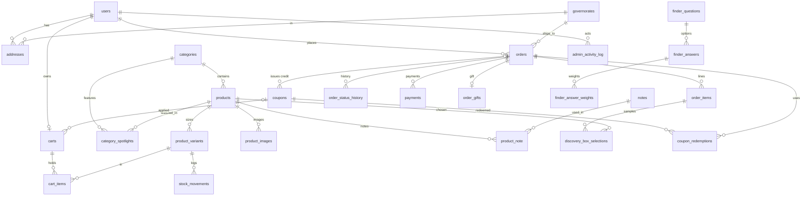

# مخطط قاعدة بيانات مداد (ERD)

قواعد عامة:
- **المبالغ** أعداد صحيحة بالقرش (`*_piasters`) لتجنّب أخطاء الكسور. ٩٥٠ ج.م = `95000`.
- **الطلب لقطة ثابتة**: اسم العطر وحجمه وسعره وعنوان الشحن تُنسخ داخل الطلب وقت إنشائه، فتعديل المنتج بعدها لا يغيّر الطلبات القديمة.
- **البحث العربي**: عمود `search_text` في `products` يحمل النص بعد التطبيع (BE-15) وعليه فهرس FULLTEXT.
- **الصلاحيات**: عمود `role` في `users` (`customer` / `staff` / `admin`) مع Gates وPolicies مكتوبة يدوياً.

## الجداول

| الجدول | الغرض | أهم الأعمدة |
|---|---|---|
| `users` | العملاء وفريق مداد | name, email (فريد), phone, password, role |
| `addresses` | عناوين العميل | governorate_id, recipient_name, phone, city, street, building, floor, apartment, landmark, is_default |
| `governorates` | المحافظات ورسوم الشحن | name, shipping_fee_piasters, delivery_days_min/max, is_active |
| `categories` | رجالي / حريمي / شرقي ونيش | slug, name, latin_name, sort |
| `products` | العطر | category_id, slug, name, latin_name, inspired_by, signature_note, description, search_text, is_active, sort, soft delete |
| `product_variants` | الأحجام ١٠/٣٠/٥٠/١٠٠ | product_id, size_ml, sku (فريد), price_piasters, compare_at_piasters, stock, reserved |
| `product_images` | صور العطر | product_id, path, alt, sort |
| `notes` | النوتات | name, slug |
| `product_note` | الهرم العطري | product_id, note_id, layer (top/heart/base/key), sort |
| `category_spotlights` | العطر المميز وهويته | category_id, product_id, tagline, palette (JSON: bg/surface/fg/muted/accent), texture, ingredients (JSON), scene_image, bottle_image, starts_at, ends_at, is_active |
| `carts` / `cart_items` | السلة (زائر بالتوكن أو عميل) | token, user_id, coupon_id · variant_id, quantity, kind (product/discovery_box), meta |
| `orders` | الطلب | number (فريد), status, payment_method, payment_status, بيانات العميل، shipping_address (JSON)، المبالغ كلها بالقرش، coupon_code, reserved_until |
| `order_items` | سطور الطلب (لقطة) | product_name, size_ml, unit_price, quantity, line_total, kind |
| `order_status_history` | تاريخ الحالات | from_status, to_status, user_id, note |
| `payments` | معاملات Paymob والدفع عند الاستلام | gateway, gateway_reference, transaction_id (فريد: Idempotency), amount, status, payload |
| `order_gifts` | الهدية | wrap, recipient_name, message (≤١٢٠ حرفاً) |
| `discovery_box_selections` | العينات الست | order_item_id, product_id, sort |
| `coupons` / `coupon_redemptions` | الكوبونات ورصيد الصندوق | code, type (percent/fixed/free_shipping), value, min_subtotal, limits, kind (general/discovery_credit), phone, source_order_id |
| `finder_*` | أسئلة «اسأل العطّار» وأوزانها | question/answer, target_type (category/note), target_id, weight |
| `settings` | إعدادات المتجر | key, value (JSON) |
| `stock_movements` | سجل حركة المخزون | variant_id, change, reason, order_id, user_id |
| `admin_activity_log` | سجل نشاط الأدمن | user_id, action, subject, changes (JSON), ip |

## حالات الطلب

`pending_payment` (دفع إلكتروني لم يكتمل) ← `placed` ← `confirmed` ← `preparing` ← `shipped` ← `delivered`
ومن أي حالة قبل الشحن: `cancelled`. وبعد التوصيل: `returned`.

الحجز: عند إنشاء الطلب يُضاف للـ`reserved` في `product_variants`. ويُفك بعد ٣٠ دقيقة إذا بقي الدفع الإلكتروني معلّقاً (Queued Job)، ويُخصم نهائياً من `stock` عند التأكيد.
